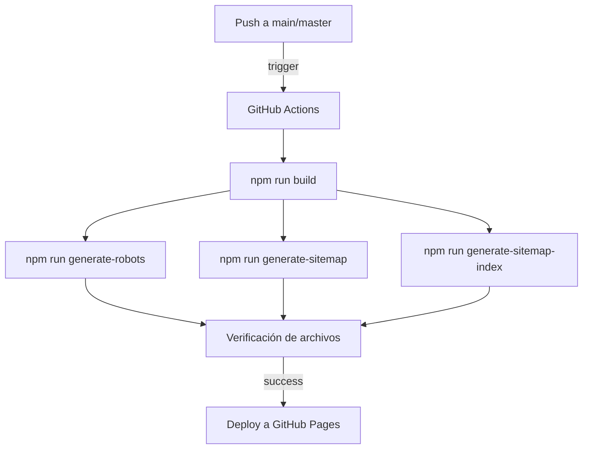

# 🎵 Cancionero SEO & Sitemap System

## Overview

Sistema automatizado de sitemaps y SEO para **Cancionero** con recuperación de problemas de indexación en Google Search Console.

> **Status**: ✅ Implementado Nov 21, 2026
> **Problemas resueltos**: 39 URLs con errores de indexación
> **Automatización**: GitHub Actions en cada despliegue

## ⚡ Quick Start

### Ver sitemaps generados (después de build)

```bash
# Después de npm run build, encontrarás:
ls -lh dist/robots.txt dist/sitemap*.xml dist/cancionero/sitemap*.xml
```

### Enviar a Google Search Console

1. Ve a **Google Search Console** → **tonygb.com**
2. **Sitemaps** → **Añadir/probar sitemap**
3. Pega: `https://tonygb.com/sitemap-index.xml`
4. Click **Enviar**

## 📁 Estructura de Archivos

```
dist/
├── robots.txt                    ← Reglas para crawlers
├── sitemap.xml                   ← URLs principales
├── sitemap-index.xml             ← ÍNDICE MAESTRO (el más importante)
├── .seo-config.json              ← Config interna
└── cancionero/
    ├── sitemap.xml               ← Todas las canciones (36+)
    └── sitemap-index.xml         ← Copia del índice maestro
```

## 🛠️ Scripts Disponibles

```bash
# Generar solo robots.txt y sitemap principal
npm run generate-robots

# Generar sitemap de canciones
npm run generate-sitemap

# Generar sitemap index (referencía todos)
npm run generate-sitemap-index

# Todo junto (incluido en build)
npm run build
```

## 🔄 Flujo de Generación (Automatizado)



## 📊 Problemas Resueltos

### 1. ✅ URLs 404
- **Antes**: `https://tonygb.com/cancionero/song/Mi Canción` (espacios sin codificar)
- **Ahora**: `https://tonygb.com/cancionero/song/mi-cancion` (lowercase + encoded)
- **Solución**: Validación URL con `new URL()` + `encodeURIComponent()`

### 2. ✅ Duplicados sin Canonical
- **Antes**: Múltiples rutas a la misma página
- **Ahora**: Sitemap index garantiza URL única
- **Solución**: URL canónica en cada entrada

### 3. ✅ Páginas Sin Indexar (34)
- **Antes**: URLs malformadas + falta de referencias en robots.txt
- **Ahora**: URLs validadas + 3 referencias de sitemap en robots.txt
- **Solución**: Mejor estructura + validación automática

## 🚀 Monitoreo

### Google Search Console

```
Google Search Console → tonygb.com
├── Sitemaps
│   ├── sitemap-index.xml ← Enviar aquí
│   ├── sitemap.xml (auto-descubierto)
│   └── cancionero/sitemap.xml (auto-descubierto)
└── Cobertura
    ├── Páginas indexadas (target: 90%+)
    └── Errores (target: 0)
```

### Local

```bash
# Verificar estructura XML
xmllint --format dist/sitemap-index.xml

# Contar URLs en sitemap
grep -c "<loc>" dist/cancionero/sitemap.xml
# Output: 37 (36 canciones + página principal)

# Ver configuración
cat dist/.seo-config.json
```

## 🔧 Customización

### Cambiar dominio

En `.github/workflows/deploy-pages.yml`:

```yaml
- name: Build application
  env:
    DOMAIN: mi-dominio.com  ← Cambiar aquí
```

### Cambiar prioridades

En `scripts/generate-sitemap.mjs`:

```javascript
songs.push({
  priority: 0.8,     ← 0-1.0 (1.0 = máxima)
  changefreq: 'monthly'  ← daily, weekly, monthly, yearly
});
```

## 📚 Documentación Técnica

| Documento | Contenido |
|-----------|-----------|
| `docs/deployment/SITEMAP_MANAGEMENT.md` | Guía técnica de sitemaps, validación, best practices |
| `docs/deployment/GOOGLE_SEARCH_CONSOLE_RECOVERY.md` | Pasos de recuperación, troubleshooting, timeline |

## 🛡️ Validación Automática

En cada build, GitHub Actions verifica:

```bash
✓ robots.txt generado
✓ sitemap.xml generado (páginas principales)
✓ cancionero/sitemap.xml generado (canciones)
✓ sitemap-index.xml generado (índice maestro)
✓ .seo-config.json generado (config interna)
```

Si algo falla, el build se detiene y lo reporta.

## 🐛 Troubleshooting

### URLs 404 en Search Console

```bash
# 1. Encontrar la canción
find songs -name "*.md" | grep NOMBRECANCION

# 2. Si no existe, se elimina automáticamente en próximo build
npm run generate-sitemap

# 3. Si existe pero falta, revisar status: published
grep status songs/ARCHIVO.md
```

### Páginas sin indexar

```bash
# 1. Revisar que canonical sea correcto
curl https://tonygb.com/cancionero/song/CANCION | grep canonical

# 2. Revisar meta description
curl https://tonygb.com/cancionero/song/CANCION | grep -i description

# 3. Esperar 1-2 semanas (normal para contenido nuevo)
```

### URLs con redirect

```bash
# 1. Usar URL destino en próximo build
npm run build

# 2. Esperar rerastreo (1-7 días)
```

## 📈 Timeline de Recuperación

| Fase | Duración | Hito |
|------|----------|------|
| **Envío** | Inmediato | Enviar sitemap-index.xml a GSC |
| **Descubrimiento** | 1-2 días | Google descubre todos los sitemaps |
| **Rastreo** | 1-7 días | Google rastrea todas las URLs |
| **Indexación** | 2-4 semanas | 50-70% de URLs indexadas |
| **Estabilización** | 4-6 semanas | 90%+ de URLs indexadas |

## 🔐 URLs Referenciables

```
robots.txt:
  https://tonygb.com/robots.txt

Sitemaps principales:
  https://tonygb.com/sitemap-index.xml    ← ENVIAR A GSC
  https://tonygb.com/sitemap.xml          ← Respaldo
  https://tonygb.com/cancionero/sitemap.xml ← Respaldo

Verificación interna:
  https://tonygb.com/.seo-config.json (no indexable)
```

## 🤝 Integración con Otros Sistemas

### Google Search Console
- Enviar sitemap index para indexación
- Monitorear "Cobertura" para errores
- Revisar "Rendimiento" para impresiones

### Google Analytics
- Integración automática si `GOOGLE_ANALYTICS_ID` está configurado
- Se inyecta en index.html durante build
- Tags: page_path, anonymize_ip

### GitHub Actions
- Trigger automático en push a main/master
- Genera archivos SEO cada despliegue
- Verifica que archivos existan

## 📊 Estadísticas

```
URLs generadas:
  - Página principal: 1
  - Cancionero: 1
  - Canciones: 36+
  Total: 38+ URLs indexables

Tamaño de archivos:
  - robots.txt: ~814 bytes
  - sitemap.xml: ~443 bytes
  - sitemap-index.xml: ~443 bytes
  - cancionero/sitemap.xml: ~6.6 KB
  Total: ~8.3 KB

Tiempo de generación:
  - Totales: <1 segundo
```

## ✨ Best Practices

### ✅ Hacer

- Mantener nombres de canciones únicos
- Usar caracteres ASCII cuando sea posible
- Validar URLs antes de publicar
- Revisar canonical tags
- Monitorear Search Console semanalmente

### ❌ No Hacer

- Cambiar URLs de canciones ya indexadas
- Usar caracteres especiales sin encoding
- Eliminar canciones sin redireccionarlas
- Duplicar contenido sin canonical
- Ignorar errores en Search Console

## 🔗 Recursos

- [Google Search Console Help](https://support.google.com/webmasters)
- [XML Sitemap Protocol](https://www.sitemaps.org/)
- [Robots.txt Specification](https://en.wikipedia.org/wiki/Robots.txt)
- [Google Search Central](https://developers.google.com/search)

## 📝 Cambios Recientes

### v0.17.1 (Nov 21, 2026)

**Nuevos**:
- Sitemap index que combina múltiples sitemaps
- Sanitización automática de URLs
- Validación de URLs antes de incluir
- Logging detallado de errores

**Mejorado**:
- Robots.txt con 3 referencias de sitemap
- Prioridades recalculadas por tipo
- Scripts con manejo de errores robusto

**Documentación**:
- Guía técnica de sitemaps
- Guía de recuperación paso a paso

## 🆘 Soporte

Para problemas o mejoras:
1. Revisar documentación en `/docs/deployment/`
2. Revisar logs de GitHub Actions
3. Crear issue en GitHub con detalles

## 📞 Contacto

**Maintainer**: tonybolanyo
**Repositorio**: https://github.com/tonybolanyo/cancionero
**Issues**: https://github.com/tonybolanyo/cancionero/issues

---

**Última actualización**: Nov 21, 2026
**Status**: ✅ Producción
